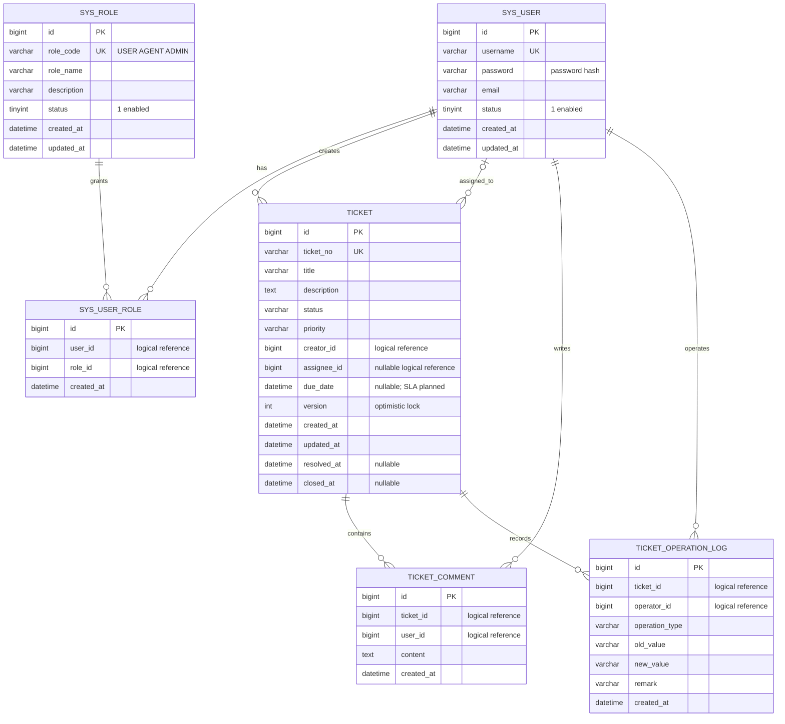
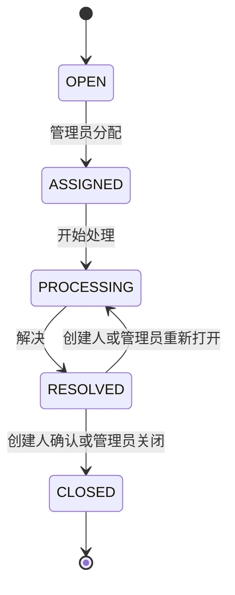

# 数据模型与设计决定

核对基线：原有六张表、实体和 Mapper；本轮补齐 ER 图、角色种子和索引实验脚本。本文的逻辑关系不是数据库已经建立的外键。测试库初始化已随本轮集成测试验证；开发库初始化/迁移及候选索引均未执行，不能混同。

## 当前六张表

实际表名使用小写：`sys_user`、`sys_role`、`sys_user_role`、`ticket`、`ticket_comment`、`ticket_operation_log`。`sys_user_role` 的 `(user_id, role_id)` 唯一约束防止重复授予同一角色。`assignee_id` 在 OPEN 阶段可以为空，创建人必填。

## 主键、唯一约束和索引

| 表 | 主键 / 唯一约束 | 当前普通索引 |
|---|---|---|
| sys_user | id；username 唯一 | 无 |
| sys_role | id；role_code 唯一 | 无 |
| sys_user_role | id；(user_id, role_id) 唯一 | user_id、role_id |
| ticket | id；ticket_no 唯一 | creator_id、assignee_id、status、created_at |
| ticket_comment | id | ticket_id、user_id、created_at |
| ticket_operation_log | id | ticket_id、operator_id、created_at |

原 Day 2 提出的三个联合索引仍完整保留为候选：

| 候选 | 待验证的访问模式 | 注意事项 |
|---|---|---|
| (status, assignee_id) | 按状态和处理人查询 | 不承诺覆盖创建时间排序；低选择性状态需要真实数据验证 |
| (creator_id, created_at) | 用户工单列表按创建时间排序 | 当前列表还有 id 排序，需要检查真实执行计划 |
| (status, priority, created_at) | 状态、优先级筛选及排序 | 缺少前导条件时不保证同样收益 |

`src/main/resources/db/migrations/V002__candidate_ticket_indexes.opt-in.sql` 只用于显式选择的实验。默认三个选择变量均为 0，直接执行不会增加索引。示例：在同一 MySQL 连接中设置 `SET @tf_index_creator_created = 1;`，再执行文件，仅选择该候选。脚本按索引名称跳过已有项，不验证同名索引是否拥有正确列序，执行前仍须读取 `SHOW INDEX FROM ticket`。

Day 8 应在独立性能数据库准备可说明分布的数据，保存原查询、EXPLAIN、耗时、数据量和环境，然后逐项比较候选。索引增加会占空间并增加写入成本；测量前不删除现有索引，不填写性能提升百分比。本轮没有执行索引 SQL。

## 外键、删除与历史保留

当前 SQL 没有物理外键。首版保留此现状，由业务层校验引用对象、角色和启用状态，并用事务保证工单与操作日志一起提交。优点是与现有测试和后续通知扩展一致；代价是绕过应用直接写库时可能产生孤儿记录。这一选择不等于“外键性能一定差”，后续可以通过数据巡检和迁移评估是否补物理约束。

原 Day 6 要求是“删除/关闭工单”。首版选择关闭：工单及历史记录保留，不提供硬删除 API；CLOSED 为终态。当前没有 `deleted` / `deleted_at` 字段，也没有启用 MyBatis-Plus 逻辑删除。逻辑删除的概念与取舍已经记录，增加删除能力留待明确的回收站、隐私清理或归档需求，不能把关闭等同于已经实现逻辑删除。

## 时间与状态

数据库时间字段使用 `datetime`，不存储时区。客户端、应用和数据库在运行及压测前应明确统一时区；当前代码的 `LocalDateTime` 不是带时区时间。`created_at` 记录创建时间，`updated_at` 记录最近一次更新，`resolved_at` 和 `closed_at` 分别记录对应业务动作。`version` 支持并发更新检测，是否检查影响行数、是否有并发测试仍必须看业务实现和验证结果。

本轮确定的业务规则：

重新打开仅允许 `RESOLVED → PROCESSING`，保留处理人，清除当前解决时间；原解决动作仍保存在操作日志中。`OPEN → CLOSED`、`CLOSED → PROCESSING` 不允许。这里是已确定的合同，代码验收状态见路线文档。

## 角色种子与凭据

新库和测试库初始化脚本新增 USER、AGENT、ADMIN 三个角色，初始启用状态为 1。`V001__seed_builtin_roles.sql` 用于已有库，重复执行只补缺少的角色，不覆盖名称、不重新启用已禁用角色、不创建用户或密码、不把任何现有用户自动变成管理员。注册合同是自动分配 USER，客户端不能提交角色进行提权。

密码字段用于安全散列，不用于返回明文密码。管理员/客服角色的首次授予需在明确的本地测试账号及目标库上单独执行和记录；公共注册接口不承担管理员引导。

## Notification：计划模型，尚无表

Notification 是原 Day 1 的概念实体，当前没有对应表、Entity 或 Mapper。保留在 Day 13–15 实现，不能把 `ticket_operation_log` 当成已完成的通知模块。

建议设计字段：id、message_id（幂等标识）、ticket_id、recipient_id、notification_type、status、payload、created_at、sent_at、last_error；实际字段和唯一约束要随通知渠道、重试及消息投递方案确定。MQ 消费成功记录与业务副作用如何原子提交、数据库事务与消息发送间的失败窗口，都在 Day 14 验收范围内。这里未创建表，也未宣称通知可以发送。
